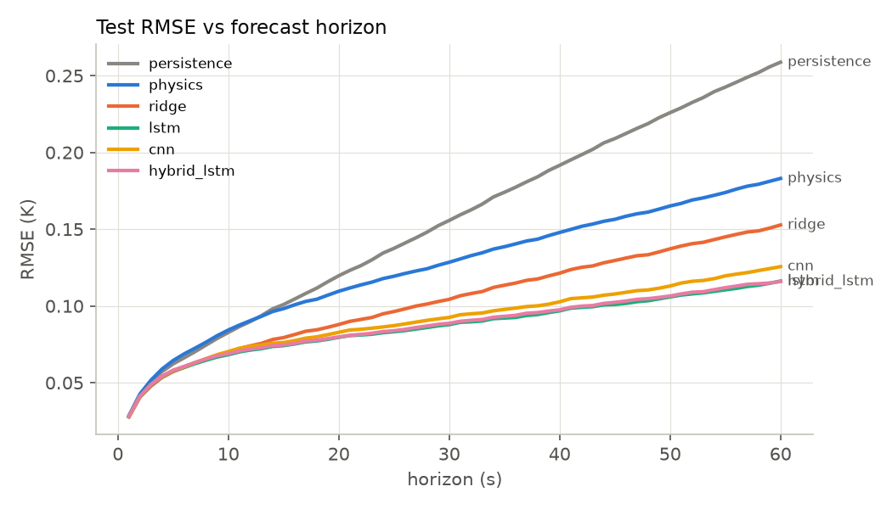

# battherm: physics-informed deep learning for Li-ion cell temperature forecasting

Forecast the surface temperature of a Li-ion cell **60 s ahead** from what a battery
management system (BMS) already measures, plus the planned load. The project compares a
grey-box physics model, linear and deep-learning forecasters, and a **hybrid model in which
an LSTM learns only the residual of the physics model**.

**Headline (LG 18650HG2, test set, 3 seeds):**

* For unseen drive cycles, the physics-residual LSTM reaches **0.089 ± 0.000 K** RMSE against
  0.168 K for persistence. At the 60 s horizon that is 80 % less squared error, with the
  lowest worst-case error.
* At an unseen 40 °C ambient, every model first **lost** to persistence. A physically
  motivated fix (monotone Arrhenius resistance, relative-temperature inputs), selected on a
  25 °C development split, brings the hybrid to **0.072 ± 0.005 K** against 0.083 K for
  persistence.

Details and caveats: [`docs/results_hg2.md`](docs/results_hg2.md).

Why it matters for thermal management: a cooling controller that knows the temperature
rise a minute in advance can pre-cool before a fast-charge or a hill climb, instead of
reacting after the cell is already hot.

## Task

At forecast origin *t* (uniform step *dt*):

| | content | shape |
|---|---|---|
| past inputs | current, voltage, temperature, ambient, current² over the last 300 s | `(W, 5)` |
| future inputs | planned current and current² for the next 60 s | `(H, 2)` |
| target | temperature rise `T[t+h] − T[t]`, h = 1..H | `(H,)` |

Errors on the rise are identical to errors on absolute temperature (`T[t]` is known).

## Models

| name | idea |
|---|---|
| `persistence` | `T[t+h] = T[t]`; the bar every model must clear |
| `physics` | lumped thermal ODE `dT/dt = I²·R(T)/C − (T − T_amb)/τ + offset`, fitted by least squares on the integral form (train cycles only), rolled forward with the future current. `R(T)`: quadratic (v1) or monotone Arrhenius `a·exp(−β(T−25))` (v2) |
| `ridge` | ridge regression on the flattened, standardised windows (alpha chosen on validation) |
| `lstm` | encoder–decoder LSTM: encoder reads the past, decoder consumes future current step by step; increment head + cumulative sum |
| `cnn` | dilated causal 1D-CNN encoder + causal CNN decoder over the horizon |
| `hybrid_lstm` | `physics + LSTM(residual)`: the network only corrects what the physics model misses. The physics forecast is also a decoder input |

## Data

1. **Synthetic** (`battherm synth`): 1-RC equivalent circuit + lumped thermal model with
   Arrhenius resistance, three load types (pulse, drive-like, constant-current) at
   −10/0/10/25/40 °C. Ground truth is known, so it is used to debug the pipeline and in unit
   tests. **Synthetic results are sanity checks, not evidence of real-world performance.**
2. **LG 18650HG2** (public; Kollmeyer, P., Vidal, C., Naguib, M., Skells, M. (2020). *LG
   18650HG2 Li-ion Battery Data and Example Deep Neural Network xEV SOC Estimator Script*.
   Mendeley Data, V3, doi:10.17632/cp3473x7xv.3, **CC BY 4.0**): drive cycles (UDDS, HWFET,
   LA92, US06, Mixed1–8) at −20…40 °C with measured cell temperature.
   * `battherm download-hg2` fetches the 70 drive-cycle CSVs (~0.6 GB) and verifies their
     SHA-256 hashes.
   * `battherm prepare-hg2` resamples them to 1 s and applies a quality filter that excludes
     7 segments: no load, or a `40degC` folder whose cells start at 23 °C.
   * The data is not redistributed here. Raw and processed data are git-ignored.

## Evaluation protocol (no leakage)

* **Whole cycles** are assigned to train/val/test; windows from one measurement never appear
  in two splits (overlapping neighbouring windows would otherwise leak).
* Two HG2 protocols: unseen **load profiles** (`hg2_profile_holdout.toml`: test US06 +
  Mixed8) and unseen **ambient temperature** (`hg2_ambient_holdout.toml`: test 40 °C).
* Scalers, the physics parameters and ridge alpha are fitted on **train/val only**.
* Hyper-parameters were tuned with `battherm sweep`, which evaluates on validation and never
  builds test windows ([`docs/tuning_log.md`](docs/tuning_log.md)). They were committed to git
  before `battherm final` evaluated the test set with 3 seeds.
* The 40 °C v2 configuration was added after the v1 test result was seen. It was selected on a
  separate 25 °C pseudo-extrapolation split (`hg2_ambient_dev.toml`) and is labelled post-hoc.
* Reported in kelvin: RMSE, MAE, max error, RMSE per horizon step, per ambient and per
  profile, plus skill vs persistence at the final step.

## Quick start

```bash
python -m venv .venv
.venv/Scripts/activate            # Linux/macOS: source .venv/bin/activate
pip install torch --index-url https://download.pytorch.org/whl/cu128   # or the CPU wheel
pip install -e .[dev]
pytest                            # unit tests incl. leakage and causality checks

battherm synth                    # -> data/processed/synthetic.csv.gz
battherm run --config configs/synthetic.toml

battherm download-hg2                            # ~0.6 GB -> data/raw/LG_HG2
battherm prepare-hg2 --raw-dir data/raw/LG_HG2   # prints an audit table; read it

# tuning: validation split only (test windows are never built)
battherm sweep --config configs/hg2_profile_holdout.toml --set lstm.hidden=64,128

# final, frozen evaluation on the test split
battherm final --config configs/hg2_profile_holdout.toml    --seeds 42 43 44
battherm final --config configs/hg2_ambient_holdout.toml    --seeds 42 43 44
battherm final --config configs/hg2_ambient_holdout_v2.toml --seeds 42 43 44
```

Each run writes `outputs/<name>_<split>_s<seed>_<timestamp>/` containing:

* the config copy, split, scalers and model weights;
* learning histories;
* metric tables and figures.

`final` adds `outputs/final/<name>/summary.md` with mean ± std. A full `final` run takes about
40 min on an RTX 4060 Laptop GPU.

## Results

Test RMSE in K, mean ± std over 3 seeds. Full tables, per-ambient breakdown and figures are in
[`docs/results_hg2.md`](docs/results_hg2.md).

| model | unseen profiles | 40 °C, v1 (pre-registered) | 40 °C, v2 (post-hoc fix) |
|---|---:|---:|---:|
| persistence | 0.168 | **0.083** | 0.083 |
| physics | 0.131 | 0.106 | 0.078 |
| ridge | 0.108 | 0.091 | 0.084 |
| lstm | 0.092 ± 0.007 | 0.109 ± 0.006 | 0.079 ± 0.006 |
| cnn | 0.094 ± 0.000 | 0.087 ± 0.006 | **0.072 ± 0.002** |
| hybrid_lstm | **0.089 ± 0.000** | 0.142 ± 0.011 | **0.072 ± 0.005** |



Lessons:

* A physics prior makes the network more accurate and much more stable across seeds. One plain
  LSTM seed had a 2.1 K outlier; no hybrid seed exceeded 0.63 K.
* A **wrong** prior is worse than none when extrapolating. A quadratic R(T) predicted twice
  the Joule heat at 40 °C than at 25 °C, and the hybrid inherited the error. Constraining the
  prior to the right physical shape (monotone R(T)) fixed it.
* The HG2 temperature sensor has 0.105 K resolution, so errors below about 0.04 K cannot be
  resolved.

The synthetic sanity check is in `docs/results_synthetic.md`. Do not quote synthetic numbers as
real performance.

## Repository layout

```
configs/                 experiment definitions (TOML)
src/battherm/
  data/schema.py         canonical columns, validation, resampling
  data/synthetic.py      electro-thermal simulator
  data/hg2.py            LG 18650HG2 loader + quality filter
  data/download.py       HG2 download with hash check
  data/windows.py        windowing, cycle-level split, train-only scaling
  models/physics.py      lumped thermal model
  models/baselines.py    persistence, ridge
  models/nets.py         encoder-decoder LSTM, causal CNN
  train.py               training loop, early stopping
  evaluate.py            metrics
  plots.py               figures
  pipeline.py            end-to-end experiment
  experiments.py         validation sweeps, multi-seed final evaluation
  cli.py                 `battherm` command
tests/                   pytest suite
docs/                    results, tuning log, design notes (Chinese), figures
```

## Limitations

* Single lumped node: surface temperature only, no core–surface gradient, no entropic heat.
* The future current is assumed known (planned load); with a predicted load the error grows.
* Resampling averages current, so `mean(I)²` slightly underestimates Joule heat for fast
  fluctuations.
* One cell type in a climate chamber. Transfer to other chemistries, packs or forced cooling
  is untested.
* Small validation set (5 cycles) and a single unseen ambient temperature. The 40 °C v2 result
  is partly post-hoc (see above).

## License

MIT (code). Datasets keep their own licences.
