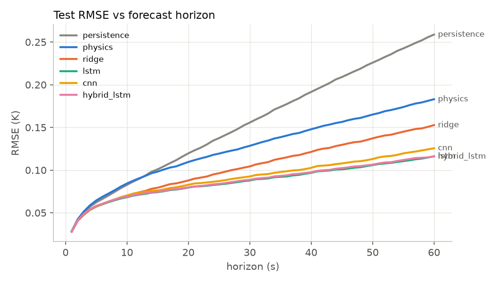
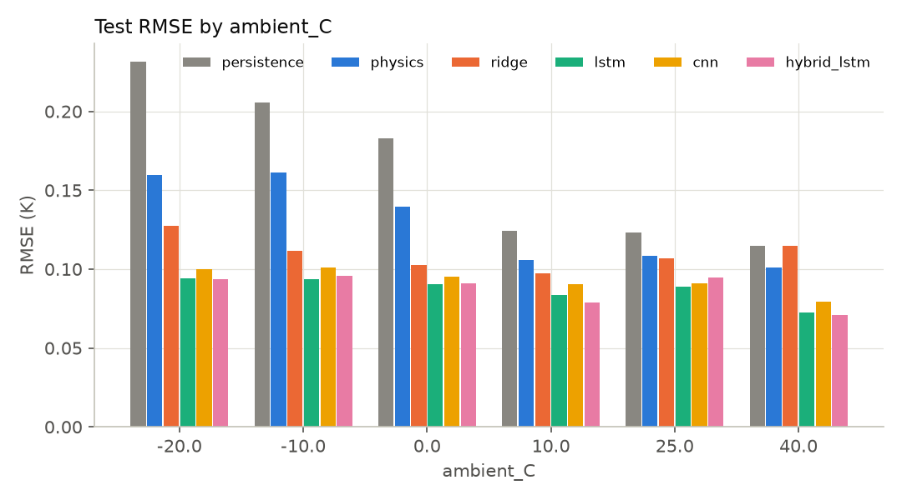
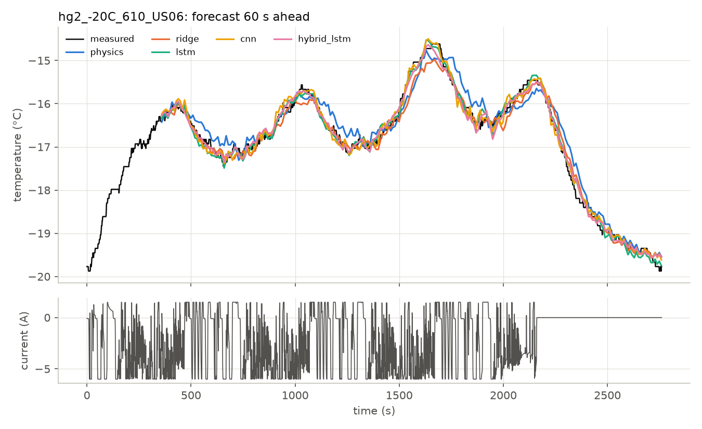
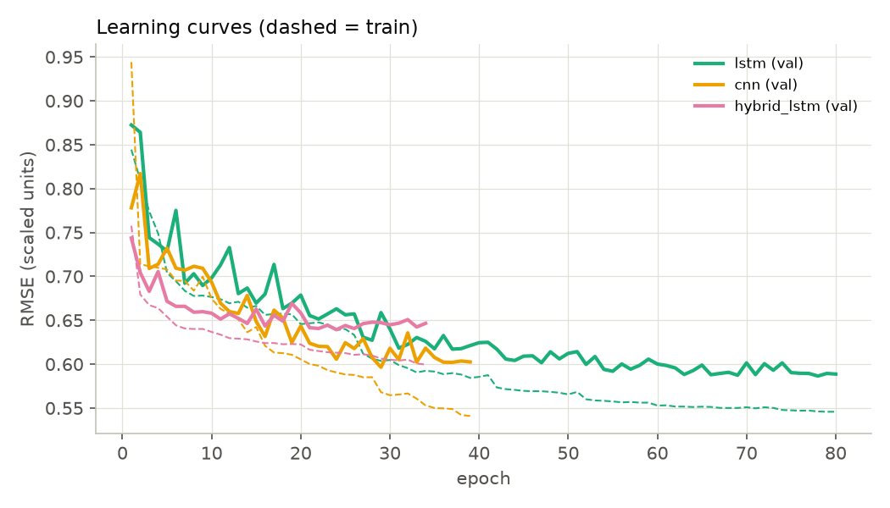
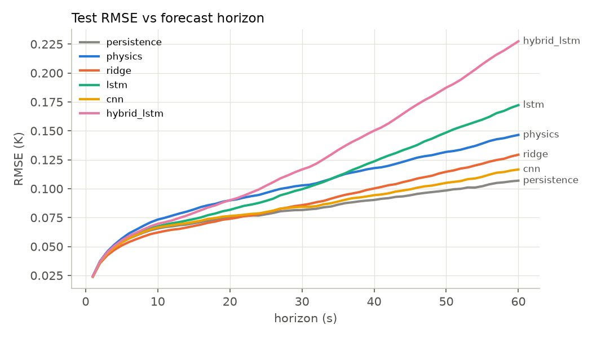
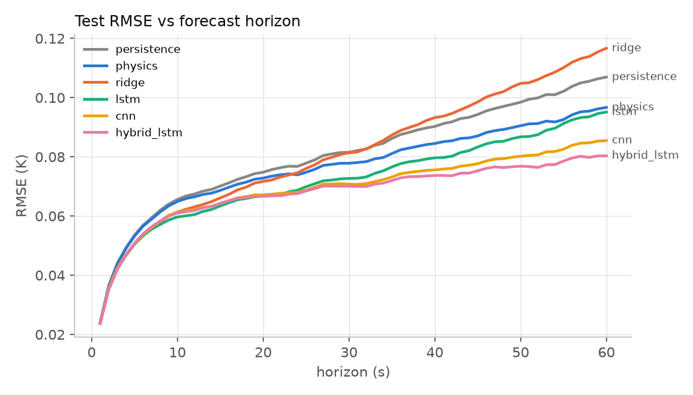
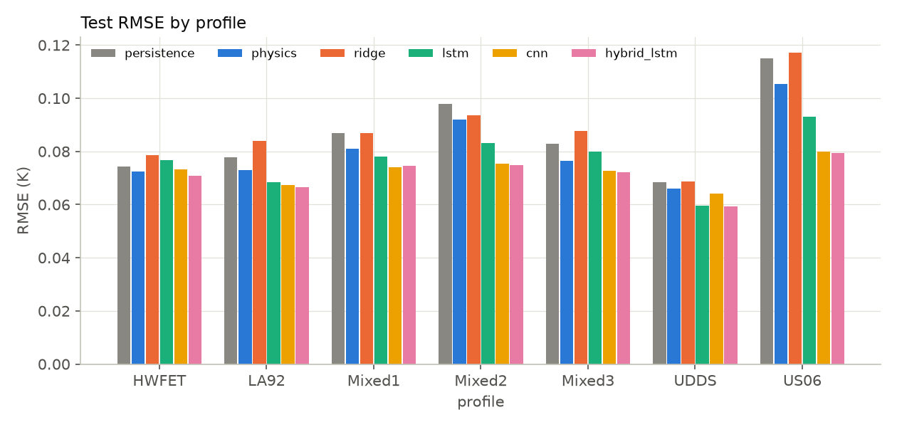
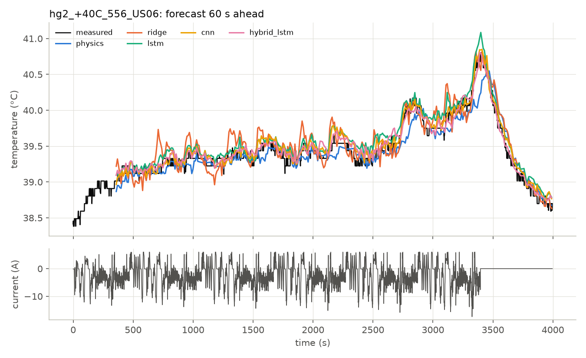

# Results on the LG 18650HG2 data

All numbers are **test-set** results, as mean ± standard deviation over 3 seeds (42, 43, 44;
sample std). Only the network weights change between seeds; the split, physics fit and ridge
are deterministic, so their std is 0. Errors are in kelvin on the 60 s temperature-rise
forecast. Error on the rise equals error on the absolute temperature.

* **RMSE / MAE / max**: over all 60 horizon steps of all test windows (stride 10 s).
* **RMSE @ 60 s**: last horizon step only.
* **skill @ 60 s** = 1 − MSE(model) / MSE(persistence) at the last step. 0 = no better than
  "the temperature stays where it is"; 1 = perfect.

Reproduce:

```bash
battherm final --config configs/hg2_profile_holdout.toml    --seeds 42 43 44
battherm final --config configs/hg2_ambient_holdout.toml    --seeds 42 43 44
battherm final --config configs/hg2_ambient_holdout_v2.toml --seeds 42 43 44
```

## Data actually used

* Kollmeyer, P., Vidal, C., Naguib, M., Skells, M. (2020). *LG 18650HG2 Li-ion Battery Data and
  Example Deep Neural Network xEV SOC Estimator Script*. Mendeley Data, **V3**,
  doi:10.17632/cp3473x7xv.3, CC BY 4.0. The drive-cycle CSVs of the original dataset were used:
  70 files at −20, −10, 0, 10, 25 and 40 °C. `battherm download-hg2` fetches them and checks
  their SHA-256 hashes.
* Resampled to 1 s. Logging gaps above 5 s split a file into segments. 72 segments, of which
  **7 were excluded** by the automatic quality filter (`hg2_audit.csv`):
  * 2 have no load (current RMS < 0.1 A): `+10C_582_LA92` and `+25C_551_HWFET`.
  * 5 are in the `40degC` folder but start at about 23 °C, 17 K below the label:
    `+40C_562_Mixed4–8`. These look like mislabelled 25 °C runs.
* 65 cycles and 443 k rows remain.
* The temperature sensor resolution is **0.105 K**, and 81 % of 1-s steps show no change. That
  sets a noise floor of roughly 0.04 K on any rise. The best models below are within a factor
  of about 2 of it.
* The chamber is not exactly at its set point: the cell rests about +0.3 K above the label at
  −20 °C and about −1.2 K below it at 25 °C. The physics model therefore has offset terms
  c0 + c1·T_amb.

## Protocol 1: unseen load profiles (`hg2_profile_holdout`)

The test profiles are US06 (the most aggressive) and Mixed8, at all ambients (11 cycles).
Validation is Mixed7 (5 cycles), and training uses the remaining 49 cycles. Hyper-parameters
were tuned on validation only (`docs/tuning_log.md`) and frozen in git before this run.

| model | RMSE (K) | MAE (K) | max abs (K) | RMSE @ 60 s (K) | skill @ 60 s |
|---|---:|---:|---:|---:|---:|
| persistence | 0.168 | 0.105 | 1.47 | 0.259 | 0.00 |
| physics | 0.131 | 0.091 | 0.97 | 0.183 | 0.50 |
| ridge | 0.108 | 0.079 | 0.71 | 0.153 | 0.65 |
| lstm | 0.092 ± 0.007 | 0.067 ± 0.001 | 1.05 ± 0.91 | 0.124 ± 0.015 | 0.77 ± 0.06 |
| cnn | 0.094 ± 0.000 | 0.070 ± 0.000 | 0.67 ± 0.07 | 0.126 ± 0.002 | 0.76 ± 0.01 |
| **hybrid_lstm** | **0.089 ± 0.000** | **0.067 ± 0.000** | **0.59 ± 0.03** | **0.115 ± 0.001** | **0.80 ± 0.00** |

RMSE by ambient (mean of 3 seeds):

| ambient | persistence | physics | ridge | lstm | cnn | hybrid_lstm |
|---:|---:|---:|---:|---:|---:|---:|
| −20 °C | 0.231 | 0.159 | 0.128 | 0.096 | 0.100 | 0.096 |
| −10 °C | 0.206 | 0.161 | 0.111 | 0.113 | 0.104 | 0.096 |
| 0 °C | 0.183 | 0.140 | 0.103 | 0.088 | 0.095 | 0.089 |
| 10 °C | 0.124 | 0.106 | 0.097 | 0.083 | 0.089 | 0.078 |
| 25 °C | 0.123 | 0.108 | 0.107 | 0.087 | 0.090 | 0.094 |
| 40 °C | 0.115 | 0.101 | 0.115 | 0.075 | 0.082 | 0.071 |

Reading:

* Every learned model beats persistence. At 60 s the networks remove 76–80 % of the
  persistence MSE.
* The hybrid is the most accurate and the most stable model:
  * lowest RMSE and lowest worst-case error;
  * almost no seed spread;
  * its best validation epoch is 19–24, against 54–80 for the plain LSTM.
* The plain LSTM has one seed (44) with a 2.1 K worst-case error and RMSE 0.101 (hence max
  1.05 ± 0.91). All three hybrid seeds stay at or below 0.63 K.
* The physics model alone captures half of the predictable rise with 6 parameters. Its fitted
  thermal time constant is about 500 s, which is plausible for a single 18650 cell in a
  chamber.
* Cold cells are hardest (largest rises, strongest resistance change). The learned models
  gain the most there.






## Protocol 2: unseen ambient temperature (`hg2_ambient_holdout`, 40 °C)

All 7 valid 40 °C cycles are the test set. Training covers −20…25 °C, so this is
**extrapolation**.

### v1 (pre-registered, same frozen settings as protocol 1)

| model | RMSE (K) | MAE (K) | max abs (K) | RMSE @ 60 s (K) | skill @ 60 s |
|---|---:|---:|---:|---:|---:|
| **persistence** | **0.083** | **0.052** | 0.63 | **0.107** | 0.00 |
| physics | 0.106 | 0.070 | 0.86 | 0.146 | −0.88 |
| ridge | 0.091 | 0.069 | 0.54 | 0.129 | −0.46 |
| lstm | 0.109 ± 0.006 | 0.074 ± 0.005 | 0.98 ± 0.16 | 0.161 ± 0.016 | −1.30 ± 0.45 |
| cnn | 0.087 ± 0.006 | 0.065 ± 0.005 | 0.48 ± 0.04 | 0.115 ± 0.012 | −0.17 ± 0.24 |
| hybrid_lstm | 0.142 ± 0.011 | 0.099 ± 0.012 | 1.06 ± 0.15 | 0.234 ± 0.016 | −3.80 ± 0.67 |

**Every model lost to persistence.** This is the honest first result.

Diagnosis, from error analysis on the test output and the fitted parameters; no parameter was
fitted to test data:

1. **The physics heat term extrapolates the wrong way.** v1 models R(T)/C as a quadratic in
   (T − 25). Fitted on −20…25 °C, the parabola bends upward again above 25 °C. It predicts
   about **2× more** Joule heat per A² at 40 °C than at 25 °C, while real resistance keeps
   falling with temperature. The error is largest on the high-current US06 profile (physics
   0.208 K vs persistence 0.115 K).
2. **The hybrid inherits that error.** It adds a residual to the physics forecast and also
   receives that forecast as an input, so it was the worst model.
3. **The LSTM sees inputs outside its training range.** Absolute cell and ambient temperatures
   of about 40 °C never occur in training (US06 RMSE 0.17 K).

### v2 (post-hoc fix, chosen without the test set)

There are two changes, both motivated by the physics rather than by the test numbers:

* `physics.heat = "arrhenius"`: q = I² · a · exp(−β (T − 25)) with β ≥ 0. Resistance now
  decreases monotonically with temperature. β is chosen by grid search on the training
  residual. A unit test checks that β is recovered on the simulator (true value 0.028 1/K) and
  that the term is monotone outside the fit range. On HG2, β ≈ 0.048 1/K.
* `windows.relative_temperature = true`: the networks see T[j] − T[t] and T[t] − T_amb
  instead of absolute temperatures. The temperature dependence of resistance is still visible
  through the voltage response.

The options were selected on a **development protocol** that copies the extrapolation one step
lower (`configs/hg2_ambient_dev.toml`: train −20…10 °C, validate on all 25 °C cycles; the 40 °C
windows are never built). Validation RMSE (K), seed 42:

| physics heat | relative T | persistence | physics | ridge | lstm | cnn | hybrid_lstm |
|---|---|---:|---:|---:|---:|---:|---:|
| poly (v1) | no (v1) | 0.117 | 0.121 | 0.115 | 0.105 | **0.090** | 0.111 |
| poly | yes | 0.117 | 0.121 | 0.110 | 0.102 | 0.094 | 0.118 |
| arrhenius | no | 0.117 | 0.107 | 0.115 | 0.105 | 0.090 | 0.095 |
| **arrhenius** | **yes** | 0.117 | **0.107** | **0.110** | **0.102** | 0.093 | **0.091** |

"Arrhenius + relative" improved 4 of the 5 non-trivial models. It cost the CNN 0.003 K, which
is within noise. The configuration was committed (`configs/hg2_ambient_holdout_v2.toml`) and
then evaluated on the 40 °C test **once**:

| model | RMSE (K) | MAE (K) | max abs (K) | RMSE @ 60 s (K) | skill @ 60 s |
|---|---:|---:|---:|---:|---:|
| persistence | 0.083 | 0.052 | 0.63 | 0.107 | 0.00 |
| physics | 0.078 | 0.053 | 0.66 | 0.097 | 0.18 |
| ridge | 0.084 | 0.061 | 0.63 | 0.117 | −0.19 |
| lstm | 0.079 ± 0.006 | 0.061 ± 0.006 | 0.47 ± 0.10 | 0.103 ± 0.010 | 0.06 ± 0.18 |
| cnn | **0.072 ± 0.002** | 0.055 ± 0.001 | 0.40 ± 0.04 | 0.089 ± 0.005 | 0.31 ± 0.08 |
| **hybrid_lstm** | **0.072 ± 0.005** | 0.056 ± 0.003 | **0.37 ± 0.05** | **0.087 ± 0.009** | **0.34 ± 0.14** |

Reading:

* v2 halves the hybrid's error (0.142 → 0.072 K). The physics model alone now beats
  persistence.
* The hybrid and the CNN are tied on RMSE. The hybrid has the lowest worst-case error.
* The margin over persistence is much smaller than in protocol 1. At 40 °C the cell has its
  lowest resistance, so the rises are small (persistence RMSE 0.083 K, against 0.168 K in
  protocol 1). Much of what is left is sensor quantisation.
* **Caveat:** v2 exists because the v1 test result was seen. The selection itself used only
  the 25 °C development split, but the decision to look for a fix did not. Treat v2 as a
  promising, partly post-hoc result, and v1 as the clean pre-registered one. A fresh
  confirmation would need another unseen temperature or another cell.
* Check on protocol 1 (validation only, seed 42): v2 changes nothing material in-distribution.
  Physics is unchanged (0.129). The hybrid improves from 0.094 to 0.083, while the LSTM and CNN
  get worse by about 0.001 K. The protocol 1 test result above therefore stays the v1 result,
  and protocol 1 was not re-tested.






## What this does and does not show

* It shows that on one public cell, at chamber conditions, a physics-residual LSTM gives the
  most accurate and most robust 60 s forecast for unseen load profiles. It also shows that a
  physically wrong prior can make a hybrid **worse** than a pure network once it extrapolates.
* It does not show transfer to other cells or chemistries, packs, forced cooling, or real
  vehicles. The future current is assumed known; with a forecast current the error will grow.
* With 5 validation cycles, differences below about 0.003 K are not meaningful.
